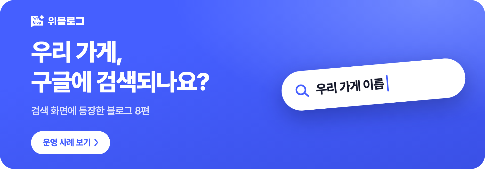
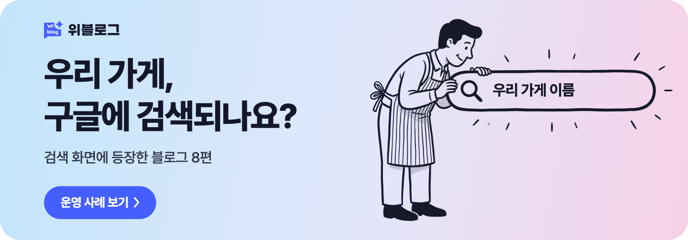
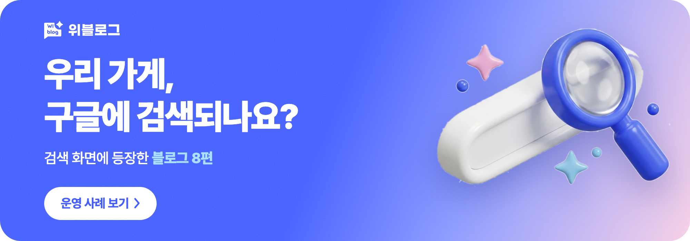
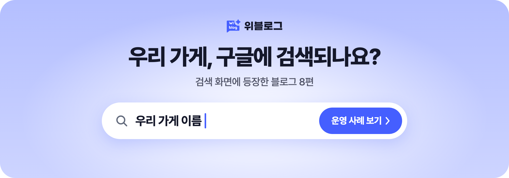
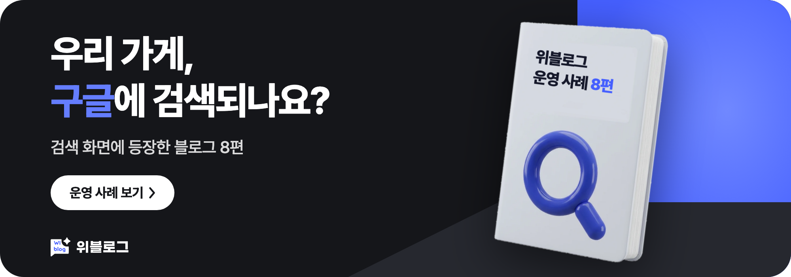
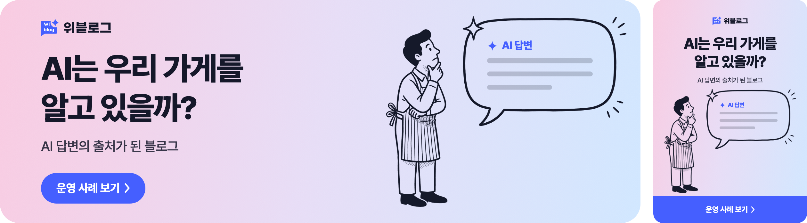
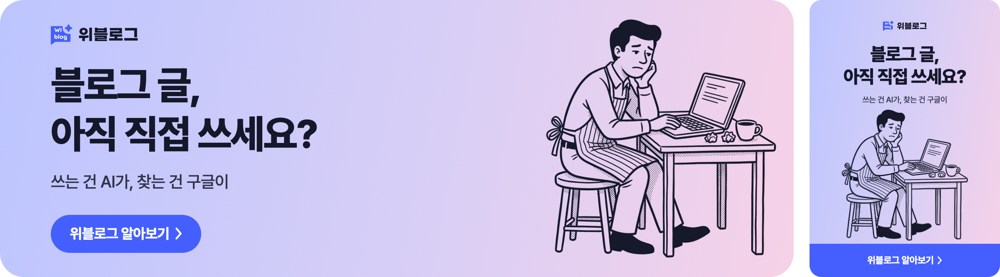

I tried making promotional banners for Wiblog with Claude Code. Five headlines, each in horizontal and vertical formats, gave me 10 banners. I worked through the copy and layouts in conversation in the terminal and used an image generation tool for the visuals that go into the banners.

The results weren't what I wanted at first. I shared references, compared several styles to find a direction, and made a few more changes to the images and copy at the end. Here's how the banners came together.

## The Process at a Glance

1. **Connect the tools** — I connected Nano Banana to Claude Code so I could handle image generation through conversation too.
2. **Provide materials** — I had it read the case study page and banner references to settle on the copy and design direction.
3. **Keep images and code separate** — Nano Banana generated the visuals, while Claude Code placed the text and buttons in code.
4. **Review the drafts** — I compared four styles with the same headline in horizontal and vertical formats and chose one.
5. **Use a reference image** — I used the chosen character image as a reference to apply the same style to the remaining headlines.

## What Should the Banners Say?

I started by having Claude Code read Wiblog's case study page and suggest content for the banners. It proposed using search result screenshots and the number of published cases.

Rather than packing in a lot of information, I wanted a simple banner made of a question and a visual. When I showed it the references I'd collected, Claude Code used their structure to suggest five question-style headlines.

| Before | After |
| --- | --- |
| This blog shows up when you search | Does our store show up on Google? |

The specific cases and search screenshots went on the page people see after clicking the banner.

## The First Draft and More References

The first draft placed a search bar, speech bubbles, and article cards on a blue background. I drew the objects in code, without image generation.

I wanted to compare other moods, so I showed it four more references for style.

## I Made the Images with Nano Banana

I connected Nano Banana to Claude Code to generate the images for the banners. For simple line-drawn character illustrations like these, Nano Banana 2.1 was enough, and I didn't need the Pro model.

To avoid garbled Korean text, I handled the illustrations and the text separately. The text inside the search bars and speech bubbles was layered on top of the images in code. I didn't need to regenerate an image when I edited the copy.

## I Compared Four Styles with One Headline

Five headlines in four styles, in both horizontal and vertical formats, would come to 40 banners. Claude Code suggested starting with just one headline: four styles in two formats each, for eight banners in total.

Using the same headline made it easier to see the differences that came from the background and the illustration.

## Making the Remaining Banners in the Chosen Style

I chose the first character illustration. I added that image as a reference and asked for the same character doing different things to match the remaining headlines.

## Wrapping Up

The 10 banners took about an hour to make. Comparing several styles first and then applying the chosen one to the remaining headlines worked well.
