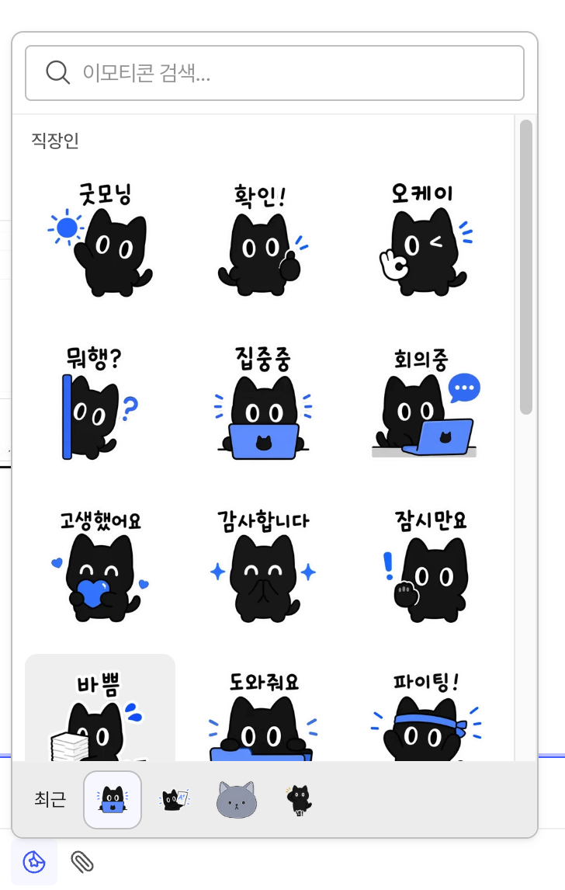
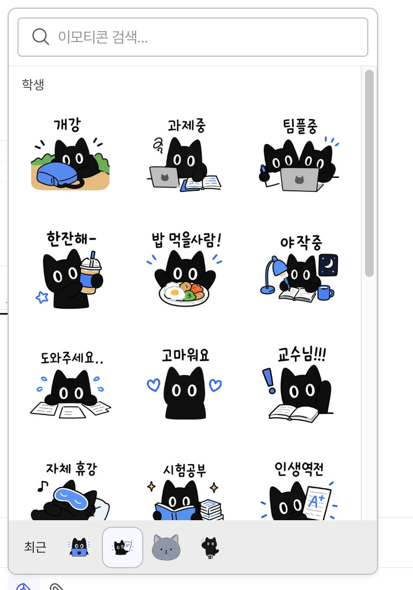

위팀에서 쓸 티미 이모티콘을 만들었어요. 직장인용과 학생용 정적 이모티콘, 그리고 움직임을 더한 모션 이모티콘까지 만들었습니다. 기존 티미 이미지를 GPT에 넣어 상황에 맞는 표정과 동작을 만들고, 모션 버전은 사내 도구로 제작했어요. 완성된 이모티콘은 개발자분의 도움으로 위팀에 등록해 실제 대화에서 사용하고 있습니다.

## 기존 티미의 표정과 동작 확장하기

티미는 [위팀 아이덴티티 리브랜딩](/ko/work/witim-identity/) 과정에서 탄생한 캐릭터예요. 사용자와 같은 방향을 바라보는 동료라는 의미를 뒷모습에 담았고, 세미콜론(;)을 고양이 형태에 적용했습니다. 이번에는 그 티미가 대화 속에서 여러 감정과 상황을 표현할 수 있도록 모습을 확장했어요.

먼저 기존 티미 이미지를 GPT에 넣었어요. 캐릭터의 기본 모습을 기준으로, 대화에서 쓸 표정과 동작을 요청했습니다. 그렇게 만든 정적 이모티콘은 직장인용과 학생용으로 나눴어요.

## 직장인용과 학생용으로 나누기

직장인용에는 “굿모닝”, “확인!”, “회의중”, “감사합니다”처럼 일하면서 자주 주고받는 말을 담았어요. 집중할 때는 노트북 앞에 앉고, 고생했다는 말에는 하트를 건넵니다. 같은 티미라도 문구에 맞춰 표정과 소품을 달리했어요.

학생용은 학교생활에 맞췄어요. “개강”, “과제중”, “팀플중”, “시험공부”부터 “밥 먹을사람!”, “자체 휴강”, “교수님!!!”까지 담았습니다. 노트북 앞에 모인 티미나 책상에 엎드린 티미처럼, 상황을 한눈에 알아볼 수 있는 장면으로 만들었어요.

<figure>
  <video controls autoplay muted loop playsinline preload="metadata" poster="/blog/timi-emoticons/mobile-stickers-poster.jpg" width="2000" height="1334" style="display: block; width: 100%; height: auto; border-radius: 12px;" aria-label="모바일 채팅에서 정적 티미 이모티콘을 주고받는 적용 목업 영상">
    <source src="/work/witim-identity/motion/simple-mode-stickers.mp4" type="video/mp4" />
    <a href="/work/witim-identity/motion/simple-mode-stickers.mp4">모바일 이모티콘 적용 영상 보기</a>
  </video>
  <figcaption>리브랜딩 작업에서 제작한 모바일 적용 목업입니다. 대화 사이에 티미 이모티콘이 들어가는 모습을 담았어요.</figcaption>
</figure>

정적 이모티콘은 라이트·다크 화면에 맞춰 두 버전으로 준비했어요.

## 사내 도구로 움직임 더하기

모션 이모티콘은 사내 도구를 활용해 제작했어요. GPT로 만든 티미 이미지에 문구와 상황에 맞는 움직임을 더했습니다.

이번 모션 세트에는 “넵!”, “퇴근!”, “화이팅”, “확인했어요”, “회의중”, “수고했어요”, “감사합니다”, “죄송해요”, “야근각”을 담았어요. 가방을 들고 뛰는 퇴근 티미, 두 손을 모아 인사하는 티미, 엎드린 몸에서 영혼이 빠져나오는 야근 티미까지. 정적 이미지에서 잡은 상황에 움직임이 더해졌습니다.

<figure>
  

    
    
    
    
    
    
    
    
    
  

  <figcaption>상황에 맞는 표정과 움직임을 담은 티미 모션 이모티콘 9종.</figcaption>
</figure>

## 위팀 채팅에서 직접 쓰기

완성된 이모티콘은 개발자분이 위팀에 등록해주셨어요. 이제 채팅창에서 직장인용과 학생용, 모션 이모티콘을 골라 보낼 수 있습니다. 브랜드 캐릭터로 시작한 티미가 “확인!”, “감사합니다”, “퇴근!” 같은 일상의 말을 전하게 됐어요.

<figure>
  <video controls autoplay muted loop playsinline preload="metadata" poster="/blog/timi-emoticons/real-chat-full-poster.jpg" width="1092" height="740" style="display: block; width: 100%; height: auto; border-radius: 12px;" aria-label="위팀 DM 채팅창 전체에서 움직이는 화이팅 티미와 동료의 파이팅 답장을 보여주는 영상">
    <source src="/blog/timi-emoticons/real-chat-full.mp4" type="video/mp4" />
    <a href="/blog/timi-emoticons/real-chat-full.mp4">실제 대화 영상 보기</a>
  </video>
  <figcaption>실제 위팀 DM에서 사용하는 모습입니다. 움직이는 “화이팅” 티미에 동료가 “파이팅!” 이모티콘으로 답했어요. 동료의 이름은 ‘김민수’라는 가명으로 표시했습니다.</figcaption>
</figure>
