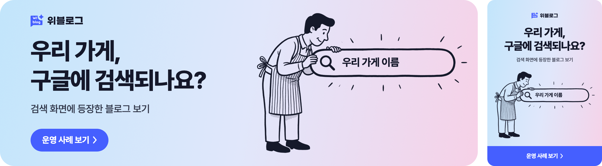
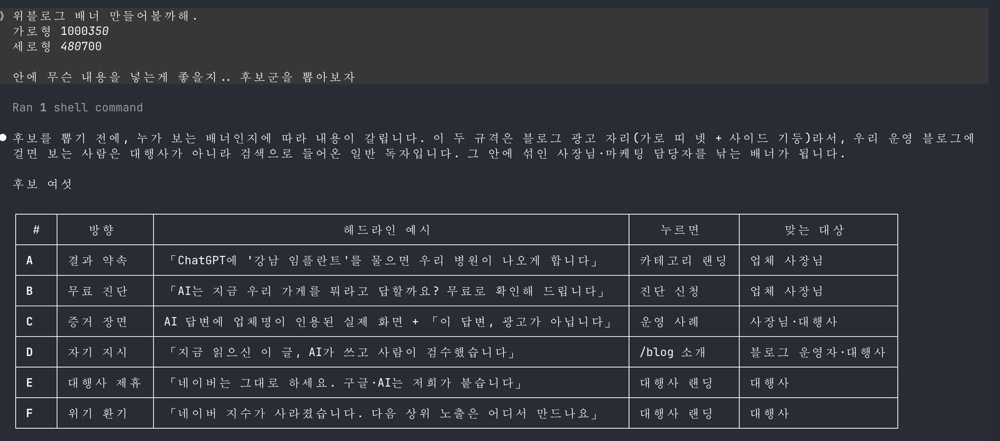
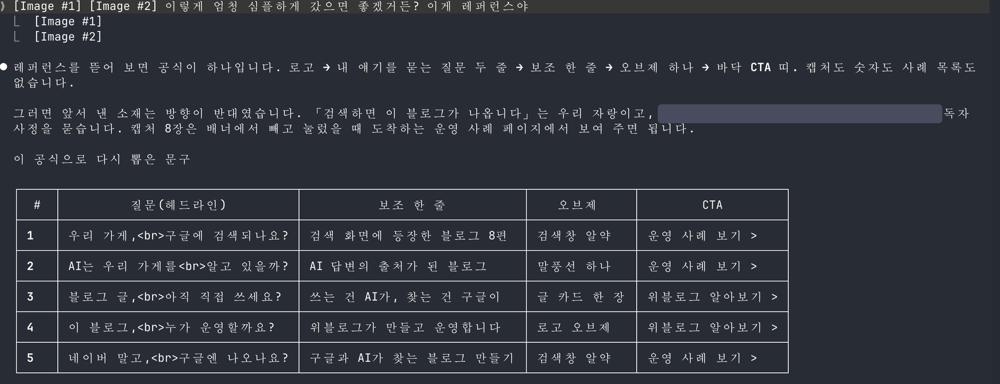
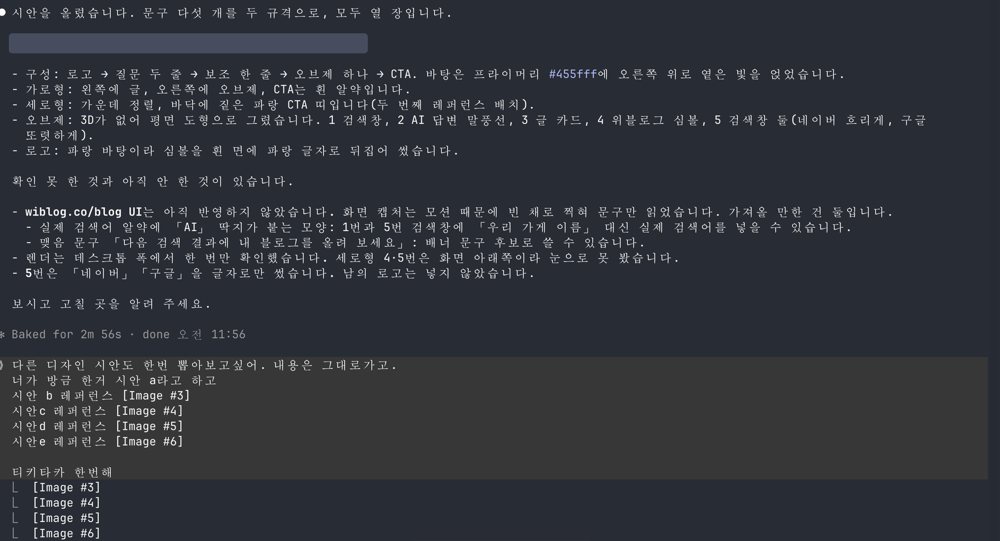
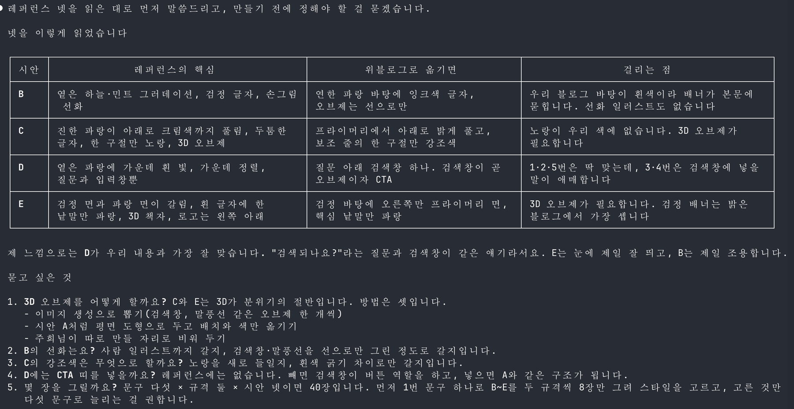
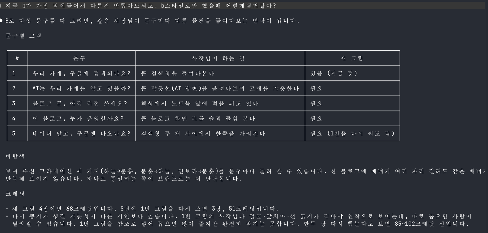
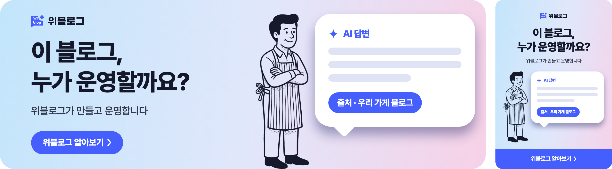
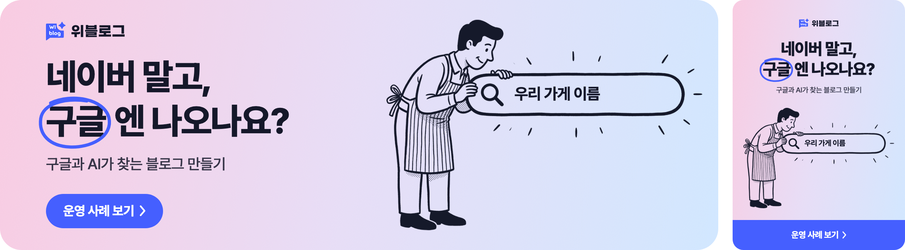

> ✏️ **초안 메모 (공개 전 지우기)**
> - 내부 회의 내용, 가격, 팀원 이름, 고객 블로그 이름과 실제 검색어는 뺐습니다.
> - 작업 화면 캡처 다섯 장은 회의 내용과 팀원 이름이 나온 부분을 잘라 내고 넣었습니다. 두 번째 캡처의 레퍼런스 브랜드 이름과 세 번째 캡처의 아티팩트 주소는 가렸습니다.
> - 배너 이미지는 아티팩트 화면을 그대로 캡처한 것입니다. 최종 파일로 바꾸려면 `src/assets/blog/wiblog-06-banner-with-ai/` 안의 파일을 같은 이름으로 덮어쓰면 됩니다.
> - 4번 배너의 이전 그림(화면 뒤를 들춰 보는 장면)은 남아 있지 않아 글에 못 넣었습니다.

## 들어가며

오늘 위블로그 배너를 만들었습니다. 문구 다섯 개에 가로형과 세로형, 모두 열 장입니다. 터미널에서 Claude Code에게 말을 걸었고, 그림은 이미지 생성 도구로 뽑았습니다.
그리는 일은 거의 AI가 했습니다. 그런데 배너가 지금 모양이 된 건 제가 "그거 말고"라고 말한 몇 번 때문이었습니다. 이 글은 그 몇 번을 적은 기록입니다.

## 첫 후보는 전부 우리 자랑이었습니다

처음에는 배너에 무엇을 넣을지부터 물었습니다. AI는 후보 여섯 개를 냈고, 운영 사례 페이지를 읽혀 주자 소재를 더 가져왔습니다. 검색 화면 캡처, 사례 편수, 「검색하면 이 블로그가 나옵니다」 같은 문구였습니다.

틀린 말은 없었습니다. 다만 전부 우리가 하고 싶은 말이었습니다.

그래서 평소 아카이빙해 둔 배너 레퍼런스를 붙여 넣었습니다. 이렇게 엄청 심플하게 갔으면 좋겠다는 한마디만 붙였습니다. AI는 그 배너들을 뜯어 보고 공식 하나를 찾아냈습니다. 로고, 질문 두 줄, 보조 한 줄, 오브제 하나, 버튼. 캡처도 숫자도 없었습니다. 그리고 스스로 이렇게 말했습니다. 앞서 낸 소재는 방향이 반대였다고요.

그 뒤로 문구는 질문이 됐습니다.

| 처음 | 바꾼 뒤 |
| --- | --- |
| 검색하면 이 블로그가 나옵니다 | 우리 가게, 구글에 검색되나요? |

캡처는 버리지 않았습니다. 배너에서 빼고, 배너를 눌렀을 때 도착하는 페이지로 옮겼습니다.

제가 한 일은 레퍼런스를 고른 것뿐입니다. 하지만 무엇이 좋은 배너인지 아는 쪽은 그 레퍼런스를 모아 둔 사람이었습니다.

## "없다"는 말을 두 번 되물었습니다

첫 시안은 파란 바탕에 평면 도형이었습니다. 검색창, 말풍선, 글 카드를 코드로 그린 것입니다.

나쁘지 않았지만 다른 스타일도 보고 싶어서 레퍼런스 넷을 더 줬습니다.

AI는 넷을 표로 정리하면서 걸리는 점을 적었습니다.

그중 둘이 "없다"였습니다.

- 강조색으로 쓸 노랑이 우리 색에 없습니다.
- 3D 오브제가 없습니다.

둘 다 사실이었습니다. 하지만 거기서 멈출 이유는 아니었습니다. 저는 이렇게 답했습니다.

- 노랑은 없지만 우리에게는 분홍과 하늘색 그라데이션이 있습니다.
- 3D 오브제는 직접 못 만드나요?

그러자 바탕은 하늘색에서 분홍으로 풀리는 그라데이션이 됐고, 오브제는 이미지 생성으로 뽑기로 했습니다. 선화로 그린 사람 일러스트도 그때 넣었습니다.

AI는 지금 손에 있는 것으로 답을 만듭니다. 브랜드 색이 몇 개인지, 어디까지 시도해도 되는지는 제가 알고 있었습니다.

## 40장 대신 8장부터 그렸습니다

이 결정은 AI의 제안이었습니다.

문구 다섯, 규격 둘, 스타일 넷이면 마흔 장입니다. AI는 1번 문구 하나로 네 스타일을 두 규격씩, 여덟 장만 먼저 그리자고 했습니다. 스타일을 고른 다음에 그것만 다섯 문구로 늘리자는 것이었습니다.

덕분에 비교가 쉬웠습니다. 문구가 같으니 눈에 들어오는 차이는 스타일뿐이었습니다. 이미지도 석 장만 뽑으면 됐습니다.

**옅은 그라데이션에 사장님 선화**

**프라이머리에서 분홍으로 풀리는 바탕에 3D 오브제**

**가운데 흰 빛과 검색창**

**검정 면과 파랑 면에 3D 책자**

하나 더 배운 것이 있습니다. 생성한 그림 안에는 글자를 넣지 않았습니다. 한글이 깨지기 때문입니다. 검색창 안의 「우리 가게 이름」이나 말풍선 속 글자는 그림 위에 코드로 얹었습니다. 그래서 나중에 문구를 고칠 때 그림을 다시 뽑지 않아도 됐습니다.

여덟 장을 나란히 놓고 저는 첫 번째, 옅은 그라데이션에 사장님 선화를 세운 시안을 골랐습니다. 가장 마음에 들었습니다.

고른 다음에는 이 스타일로만 다섯 문구를 그리면 어떻게 될지 물었습니다. 같은 사장님이 문구마다 다른 장면에 서는 연작이 된다는 답이 왔습니다.

## 모델은 제가 물어보고 나서야 바뀌었습니다

처음 석 장을 뽑는 데 51크레딧이 나갔습니다. 한 장에 17크레딧입니다.

나머지 그림을 뽑기 전에 하나를 물었습니다. 지금 어떤 모델을 썼느냐고요. 나노바나나 프로였습니다. AI가 골랐고, 저에게 묻지는 않았습니다.

나노바나나 2.1로 견적을 다시 받아 봤습니다.

| 모델 | 한 장 | 쓴 장수 | 합계 |
| --- | --- | --- | --- |
| 나노바나나 프로 | 17크레딧 | 3장 | 51크레딧 |
| 나노바나나 2.1 | 3크레딧 | 4장 | 12크레딧 |

검정 선화는 3D 렌더보다 단순해서 2.1로도 충분했습니다. 첫 그림을 참조로 넣으니 같은 사장님이 다른 장면에 섰고, 석 장 모두 한 번에 쓸 만하게 나왔습니다. 전체로는 63크레딧을 썼습니다.

AI는 좋은 결과를 내는 쪽으로 고릅니다. 얼마를 쓸지는 묻지 않으면 말하지 않습니다. 그 뒤로는 돌리기 전에 견적부터 받았습니다.

## 문구와 배치는 직접 손봤습니다

열 장이 다 나온 뒤에도 그대로 쓸 수는 없었습니다. 제 눈에 걸리는 곳이 둘 있었습니다.

**4번 그림이 문구와 다른 말을 했습니다.** 문구는 「이 블로그, 누가 운영할까요?」이고, 답은 「위블로그가 만들고 운영합니다」입니다. 그런데 처음 그림 속 사장님은 블로그 화면 뒤를 들춰 보며 궁금해하고만 있었습니다. 질문만 있고 답이 없는 그림이었습니다.

그림을 한 번 다시 뽑았고, 그래도 요소가 많았습니다. 결국 화면과 펜을 빼고 팔짱 낀 사장님만 남겼습니다. 그 옆에 AI 답변 카드를 직접 놓았습니다. 사장님은 맡겨 두고 웃고 있고, 블로그는 AI 답변의 출처가 되어 있습니다.

**「8편」이 작아 보였습니다.** 1번의 보조 문구는 원래 「검색 화면에 등장한 블로그 8편」이었습니다. 정확한 숫자였지만, 배너에 올려 보니 자랑이 아니라 규모가 작다는 고백처럼 읽혔습니다. 숫자를 빼고 「검색 화면에 등장한 블로그 보기」로 바꿨습니다.

둘 다 AI가 틀린 것은 아닙니다. 시킨 대로 그렸고, 사실대로 썼습니다. 다만 배너를 처음 보는 사람이 어떻게 읽을지는 제가 봐야 했습니다.

## 제 말이 틀린 적도 있었습니다

5번 문구는 「네이버 말고, 구글엔 나오나요?」입니다. AI는 「구글」에 손으로 그린 듯한 동그라미를 쳤습니다. 저는 그림에 있는 반짝이 선과 맞추고 싶어서, 동그라미를 반짝이 선으로 바꿔 달라고 했습니다.

AI는 할 수는 있지만 동그라미가 낫다고 답했습니다. 이유도 댔습니다. 반짝이 선은 "여기 주목"이고, 동그라미는 "이걸 고른다"입니다. 이 문구는 둘 중 하나를 고르는 말이라 동그라미가 맞다는 것이었습니다.

그래도 보고 싶어서 두 안을 다 그려 달라고 했습니다. 나란히 놓고 보니 별로였습니다. 동그라미로 되돌렸습니다.

말로 들었을 때는 수긍이 안 됐고, 그려 놓고 보니 바로 알았습니다. 그려 보는 비용이 거의 없으니, 설득당하기 전에 눈으로 확인하면 됩니다.

## 마치며

한 시간 동안 누가 무엇을 했는지 나눠 보면 이렇습니다.

| AI가 한 일 | 제가 한 일 |
| --- | --- |
| 문구 후보와 스타일 시안을 그렸습니다 | 레퍼런스를 골라 방향을 정했습니다 |
| 40장을 8장으로 줄이자고 했습니다 | "없다"는 말에 우리가 가진 것을 알려 줬습니다 |
| 열 장을 한 페이지에 깔았습니다 | 비용을 묻고 모델을 바꿨습니다 |
| 동그라미가 맞다고 했습니다 | 문구와 배치를 마지막에 손봤습니다 |

AI와 일하면서 디자이너의 일이 줄었는지는 잘 모르겠습니다. 그리는 시간은 분명히 줄었습니다. 대신 고르고, 되묻고, 빼는 일이 남았습니다. 오늘 배너에서 제 몫은 그쪽이었습니다.
